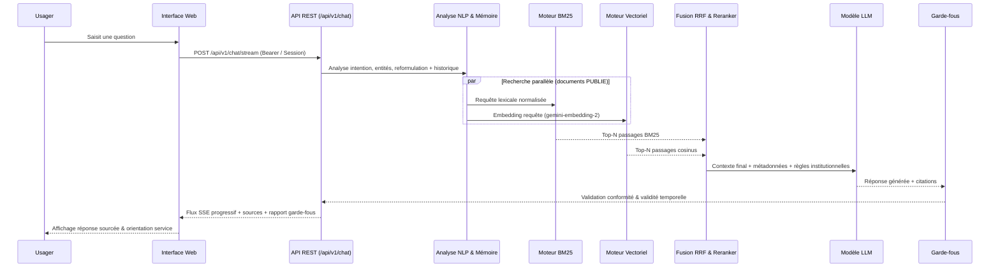

# Architecture Technique — Agent Conversationnel RAG Hybride DGECC

## 1. Vue d'ensemble des 6 sous-systèmes

1. **Pipeline Documentaire (`server/document_processing/`)** : Ingestion multipart (PDF, DOCX, HTML, TXT), extraction de texte brut, normalisation typographique française, découpage glissant configurable (`chunkSize`, `chunkOverlap`) avec traçabilité documentaire, vectorisation via modèle d'embeddings interchangeable (`gemini-embedding-2`) et indexation lexicale BM25 + vectorielle.
2. **Stockage des Données (`server/database/` & `database/init.sql`)** : Séparation stricte entre données documentaires, données d'indexation, données conversationnelles isolées par utilisateur/session et données administratives (RBAC + audit logs).
3. **API Backend REST (`server/api/`)** : Endpoints sécurisés `/api/v1/*`, authentification par hachage `scrypt` + jeton signé HMAC-SHA256, limitation de débit (rate limiting), validation stricte des entrées et spécification OpenAPI 3.0 (`/api/v1/openapi.json`).
4. **Intelligence Conversationnelle (`server/nlp/`, `server/memory/`, `server/search/`, `server/rag/`, `server/llm/`, `server/guardrails/`)** :
   - **Analyse NLP** : Détection d'intention, extraction d'entités administratives et temporelles, reformulation contextuelle.
   - **Mémoire Conversationnelle** : Fenêtre glissante bornée et isolée par session/utilisateur avec conservation des sources déjà consultées.
   - **Recherche Hybride Parallèle** : BM25 (Okapi $k_1 = 1.5, b = 0.75$) exécutée en parallèle de la recherche cosinus vectorielle sur les documents au statut `PUBLIE` uniquement.
   - **Fusion RRF & Reclassement** : $\text{RRF}(d) = \sum \frac{w_i}{k + \text{rank}_i(d)}$, suivie d'un reclassement par recouvrement d'entités et validité temporelle.
   - **Génération & Garde-fous** : Génération strictement ancrée sur le corpus validé avec contrôle post-génération (vérification des citations, validité temporelle, détection d'injections de prompt et refus sécurisé).
5. **Interface Utilisateur (`src/`)** : Espace Usager (accueil institutionnel, assistant conversationnel avec streaming progressif, sources vérifiées, orientation administrative) et Espace Administrateur (workflow de validation documentaire, RBAC, journaux, évaluation RAG).
6. **Évaluation & Métriques** : Calcul automatisé de `Recall@K`, `Precision@K`, `MRR`, `NDCG@K`, `Faithfulness`, `Answer Relevancy`, `Context Precision`, `Context Recall` et latence par étape.

## 2. Diagramme de Séquence — Flux Question Usager

